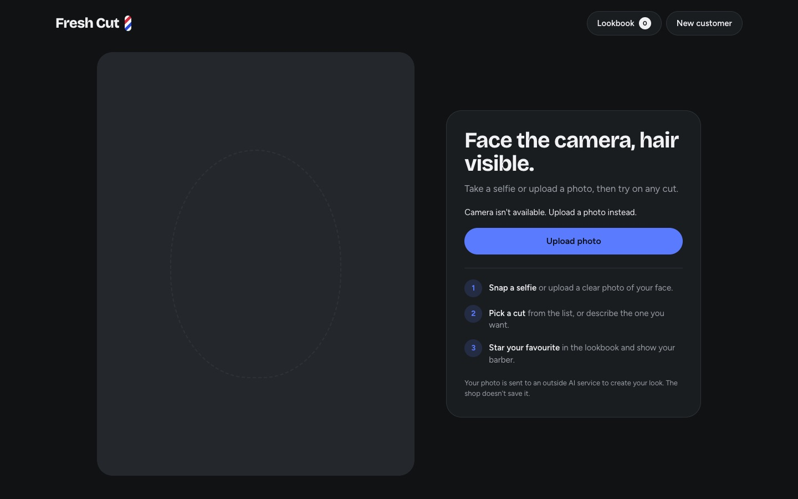
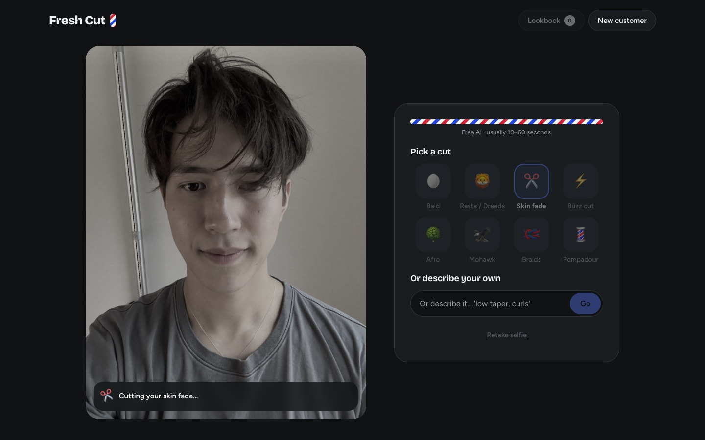
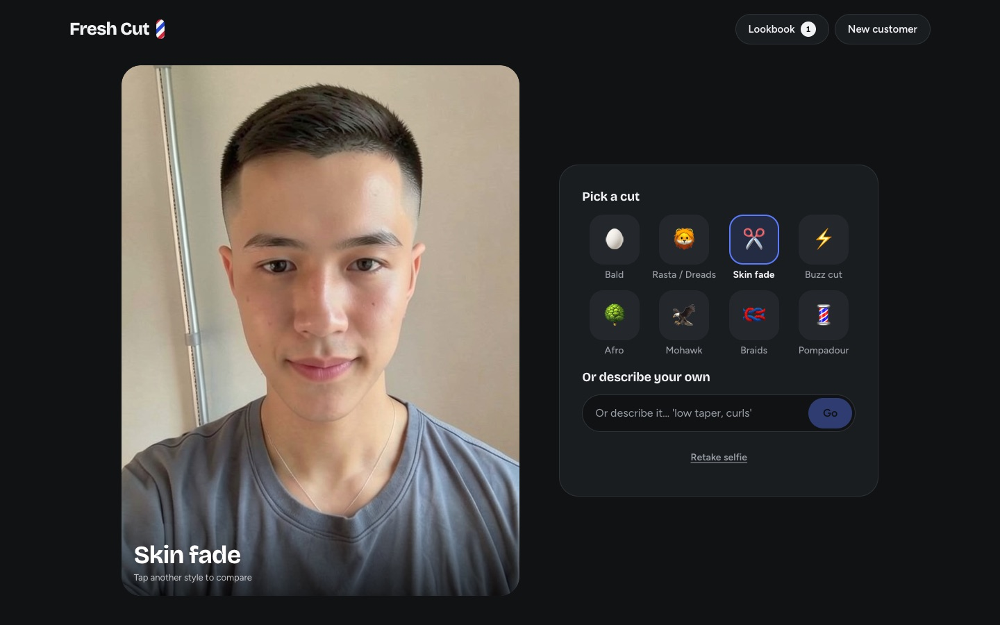
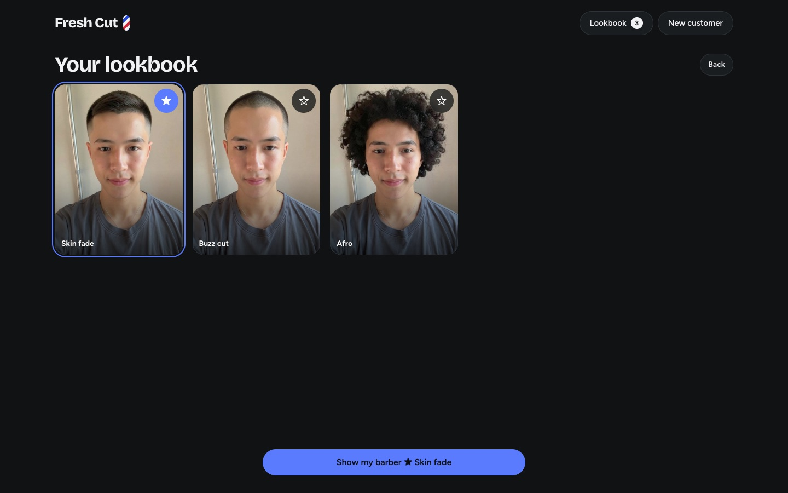
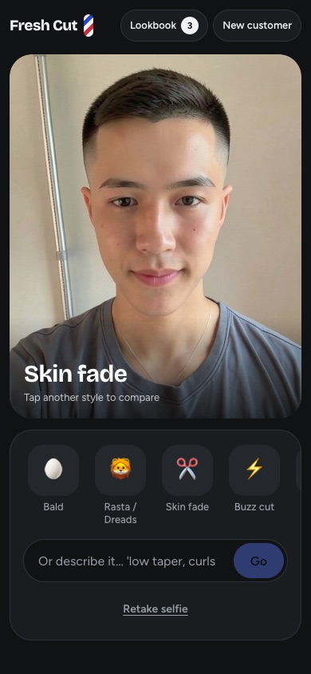
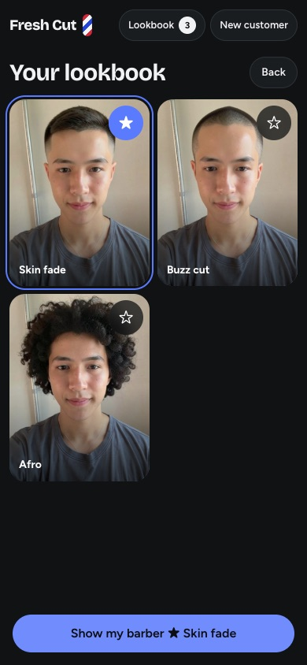
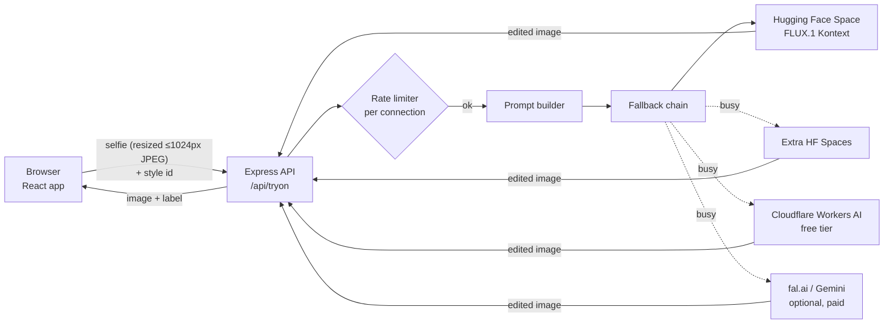

# FRESH CUT: AI hairstyle try-on for a barbershop

A web app built for a real barbershop. A customer takes a selfie (or uploads a photo), picks a
haircut, and the AI shows them wearing it, keeping their face, skin tone, clothes and background
the same. They save favourites to a lookbook and tap **Show the barber** to show the chosen cut
full screen.

No accounts, no database, and no photos are stored. It runs entirely on free services.

> **Stack:** React 19 · TypeScript · Vite · Node.js / Express 5 · FLUX.1 Kontext (Hugging Face) · Vitest
> · deployed on Render

<table>
  <tr>
    <th>Before</th>
    <th>Skin fade</th>
    <th>Buzz cut</th>
    <th>Afro</th>
  </tr>
  <tr>
    <td></td>
    <td></td>
    <td></td>
    <td></td>
  </tr>
</table>

<sub>Real output from the app. The "before" portrait is an AI-generated, fictional person, not a
real customer.</sub>

## Screenshots

**Desktop**

| Start | Generating |
| --- | --- |
|  |  |
| **Result** | **Lookbook** |
|  |  |

**Phone**

<p>
  
  &nbsp;
  
</p>

---

## Features

- **Selfie or upload.** Live front camera with a mirrored preview, or a photo from the gallery.
  Works in iOS Safari and Android Chrome, and can be installed to the home screen as a PWA.
- **8 preset styles** (Bald, Rasta / Dreads, Skin fade, Buzz cut, Afro, Mohawk, Braids, Pompadour),
  or describe your own in free text.
- **Lookbook.** Every generated look is kept for the session. Customers can star favourites and
  compare them.
- **Show the barber.** A full-screen view of the chosen look to hand to the barber.
- **New customer.** One tap wipes the session, so the app is safe on a shared shop tablet.
- **Phone, tablet and desktop layouts.** The phone's back button and swipe-back move between
  screens without losing looks.
- **Never leaves customers stuck.** If the free AI is busy, it falls back to other services
  automatically, and shows a friendly "try again" message only when all of them are busy.

## How it works



1. **Client side**, the photo is decoded with EXIF rotation applied, scaled down to 1024px and sent
   as a JPEG data URL. Smaller uploads mean faster generations and less of the free quota used.
2. **The server** checks the input, applies a fair-use limit, and turns the chosen style into an
   edit prompt such as *"Change only the person's hairstyle to a clean skin fade… Keep the face,
   skin tone, expression, clothing and background identical."*
3. **A provider chain** sends the request to the first AI service that is available and returns
   the edited image. Nothing is written to disk or logged.

## Engineering highlights

**Pluggable AI providers with automatic fallback** (`server/provider/`)
Every AI service implements one small interface, `edit(image, prompt, signal) → image`.
`createFallbackProvider` tries them in order. When a service reports "busy" or "out of quota", it
is skipped for 5 minutes, so later customers go straight to the next service instead of waiting
for the same timeout. The chain is built from environment variables. Adding a key enables that
service, and no code changes are needed.

**Fair-use rate limiting** (`server/rateLimit.ts`)
A dependency-free limiter allows at most 2 concurrent generations and 10 per rolling minute per
connection. It evicts idle keys so memory doesn't grow with every visitor, and it takes an
injectable clock so tests are deterministic.

**Cancelling abandoned work**
If a customer leaves or retakes their photo mid-generation, the browser aborts the request. The
server notices the closed connection and aborts the upstream AI call through an `AbortSignal`,
so no quota is spent on a result nobody will see.

**Security and privacy**
- API keys live only in server-side environment variables. They are never sent to the browser,
  never logged, and never committed (`.env` is gitignored, and `.env.example` has placeholders only).
- Input is checked strictly: only `jpeg/png/webp` data URLs, an 8 MB body cap, free text limited
  to 200 characters, and style ids from a fixed catalog shared by client and server.
- Errors come back as short codes (`BUSY`, `TIMEOUT`, `FAILED`, `TOO_LARGE`) with no stack
  traces or upstream details. `x-powered-by` is disabled.
- Images exist only in memory for the length of the request and in the customer's browser tab.

**Mobile details**
- iOS Safari quirks: `playsinline` camera playback, an `` fallback where
  `createImageBitmap` options aren't supported, and no reliance on `crypto.randomUUID`.
- Android gallery apps that return files with no MIME type are still accepted, and the image
  decoder decides whether they're valid.
- Screens are mirrored into `history.pushState`, so hardware back and swipe-back behave like a
  native app.
- Respects `prefers-reduced-motion`.

**Predictable UI state** (`src/state/session.ts`)
The whole session (selfie, looks, favourites, pending request, error, current screen) is one
reducer with typed actions. That makes behaviour such as "a new selfie clears the current look"
or "ignore Start while a look is generating" easy to reason about and to unit test.

## Testing

**115 tests across 12 files** (Vitest, Testing Library, Supertest), covering:

- the API route: validation, rate limiting, error mapping, abort on disconnect
- the fallback chain: ordering, busy cooldown, abort propagation
- the Hugging Face provider: response parsing, busy and timeout mapping
- the prompt builder and style catalog
- the rate limiter, using a fake clock
- image resizing and the API client
- the session reducer
- the Selfie, Studio and Lookbook screens

```bash
npm test
```

## How I built it

I worked spec first and in small, test-driven steps. The commit history shows the progression:

1. **Design spec**: requirements gathered with the shop owner, covering the customer flow,
   privacy rules and free-hosting constraints (`docs/superpowers/specs/`)
2. **Implementation plan**: the work split into small tasks, each one testable on its own
   (`docs/superpowers/plans/`)
3. **Backend first**: the style catalog and prompt builder, then the rate limiter, the Hugging
   Face provider and the `/api/tryon` route, each with tests
4. **Frontend**: image resizing and the API client, then the session reducer and the screens
   (selfie → studio → lookbook → show the barber)
5. **Hardening from real-device testing**: iOS camera playback, phone layout, aborting abandoned
   generations, and a shop-wide limiter for shared Wi-Fi
6. **Redesign**: a modern UI, Android and iOS PWA support, and laptop and desktop layouts
7. **Resilience**: backup AI services once the free Hugging Face quota turned out to be the main
   bottleneck in practice

## Project structure

```
server/            Express API
  app.ts           /api/tryon route, validation, error mapping
  rateLimit.ts     per-connection fair-use limiter
  prompt.ts        style → edit prompt
  provider/        AI services (Hugging Face, Cloudflare, fal.ai, Gemini) and the fallback chain
shared/styles.ts   style catalog shared by client and server
src/               React app
  screens/         Selfie, Studio, Lookbook, ShowBarber
  state/session.ts session reducer
  lib/             image resizing, API client
tests/             mirrors server/, shared/ and src/
scripts/           try-model.ts, a CLI for testing other AI models and styles
```

## Run it locally

Requires Node.js 22.12+.

```bash
npm install
cp .env.example .env    # add your own free Hugging Face token (see the setup guide)
npm run dev             # http://localhost:5173
```

The full setup, environment variables, free backup AI services, and deploying to Render are
covered in **[docs/SETUP.md](docs/SETUP.md)**.
